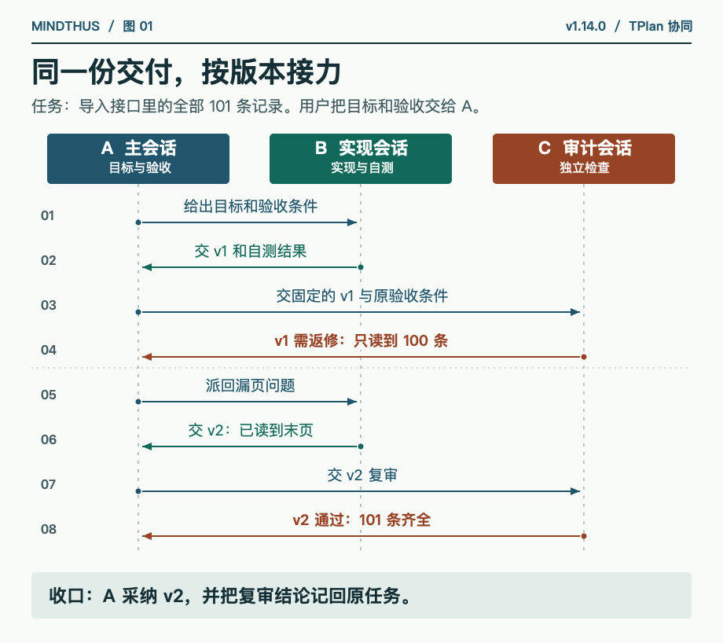
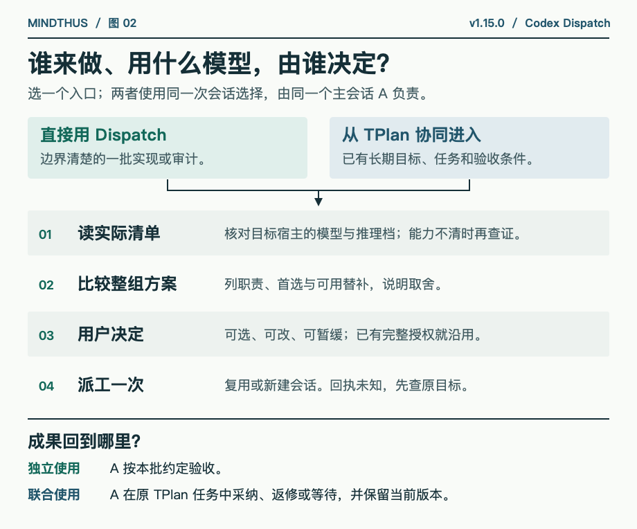

# 多会话工作指南：什么时候用 TPlan，什么时候用 Dispatch？

如果只是要在 Codex 里把一批活交给合适的模型，直接用 **Dispatch**。如果工作要跨几个阶段，你还希望主会话记得原目标、为什么返修、哪个版本已经验收，就用 **TPlan 协同**。从 v1.15.0 起，在 Codex 中配置 TPlan 协同时，主会话会直接调用 Dispatch 决定怎么用会话。你只需从一个入口开始。

| 你的情况 | 合适的入口 | 这次会得到什么 |
|---|---|---|
| 临时查一个字段或比对两处文档 | 当前会话；需要时用临时 SubAgent | 查证结果回到当前对话。在 TPlan 中，临时 SubAgent 做只读调查。 |
| 有明确范围和验收样例，希望不同模型分别实现、审计 | Codex Dispatch | 先看整组人选、推理档和取舍，再决定是否派工。本批可以不建 Mission。 |
| 长任务有多轮交付，需要保留目标、返修责任，或中断后接着做 | TPlan 协同；在 Codex 中默认进入 Dispatch | 模型方案服从同一任务和已有授权，最终成果回到原 Mission 验收。 |
| 已在其他宿主手动安排了参与会话 | TPlan 协同 | A 继续管理目标和证据，通过该宿主已有的方式联系参与者。 |

## 图一：TPlan 怎样跟住同一项交付

下面是一个教学例子。用户要“导入所有 101 条数据”，源接口分两页，第一页恰好 100 条。**A 是主会话，B 负责实现和自测，C 独立审计。只有 A 需要运行 TPlan。**

B 和 C 都在自己的普通会话里工作。派工时 A 就在说明里写清 B 把固定版本交给谁、什么时候交、用哪条已经授权的回程——通常是 B 完成后往 A 的会话发一次交付消息。B 可以自行查明分页机制、修复并补测，也把“原设计按单页写、实际需要遍历游标”记进偏差清单。交付消息到达后 A 才验收或交给 C；B 返修了，C 就检查新版本。A 在交付时把分页约定写回设计。若发现源端根本只保留 100 条，是否调整目标则要提前交给 A 决定。

在较长任务里，A 和 B 可以事先约定一个看得见的检查点，例如“取回末页，并给出 101 条的计数证据”。到点回看哪条验收差距缩小了；普通进度留到交付时一起说，等待期间 A 不对同一份未交付的实现抢先验收。A 派工并记下恢复条件后就可以让出回合，由 B 的交付消息驱动接手；B 还没交付时，A 不因为等待超时就反复查进度或提前开始同一项工作。

## 图二：Dispatch 怎样决定用哪些会话

还是上面的任务。字段契约和样例已写清时，可以给 B 配执行模型，把较强的独立判断留给 C；如果问题跨越读写两条路径，可以给 B 更强的排障模型或推理档。哪套方案可用，取决于目标宿主当时实际提供的型号和档位。

A 为各职责列出首选与一至两个合格替补，并标出各自的推理档；合格人选不足时把缺口说清。你可以选整组、只改 B 的档位，也可以暂缓。点名了完整组合并已授权执行时，A 核对后直接派工。首个指令已随新会话创建发出，派工里同时写清 B 完成后沿已授权的回程交付一次；A 记下恢复条件后等那次交付到达，而不是反复查看进度。派工的下行消息与交付的上行消息不一样：B 还在做当前一项时，A 不趁它忙塞新活或换档，等它交接出这一项；B 把已固定的包交付给正在等的 A 时，可以按约直接发，不必等 A 显示空闲。

每条跨会话消息开头带一行抬头，第一眼就看清实际谁发给谁、意图和任务/轮次。例如 A 给 B 派工：

> [派工] 「导入修复·协调」(A) → 「导入修复·实现」(B)。任务 import-fix，轮次 R1，事件 dispatch。

B 交付回来就是上行；真正把一条交付转给 C 审查时，抬头先写实际发件的 A 和最终收件的 C，原作者另标，不伪装成原作者或你：

> [转发] 「导入修复·协调」(A，转发) → 「导入修复·审查」(C)；原作者 「导入修复·实现」(B)。任务 import-fix，轮次 R1，原事件 delivery，版本 a1b2c3d。

同名或跨宿主时按稳定会话引用区分，新建收件人还没有 ID 就用约定的名字。宿主只返回待建引用时，A 先核对原目标，不会因暂时没看见正式会话 ID 就再派一份。

## 两种可以直接用的说法

**独立派一批工作：**「用 Dispatch 帮我安排这次导入修复。B 实现、C 独立审计；先给我两组这台机器可用的模型和推理档，我选完再开始。」

**让主会话管到验收：**「用 TPlan 管这次导入改造，验收条件是 101 条都读到。需要分工时先给我会话方案；实现交固定版本后再审计，返修后用新版本复审。」在 Codex 中，这一句已经包含 Dispatch 的选型步骤。

[v1.14.0：TPlan 协同发布说明](../releases/v1.14.0.md) · [v1.15.0：Dispatch 发布说明与下载](../releases/v1.15.0.md)
