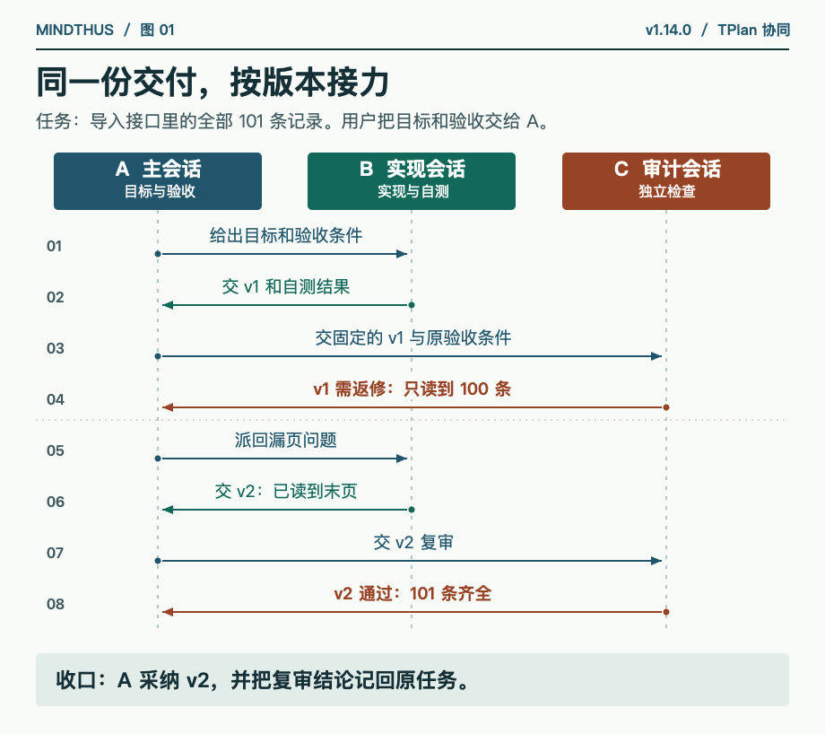
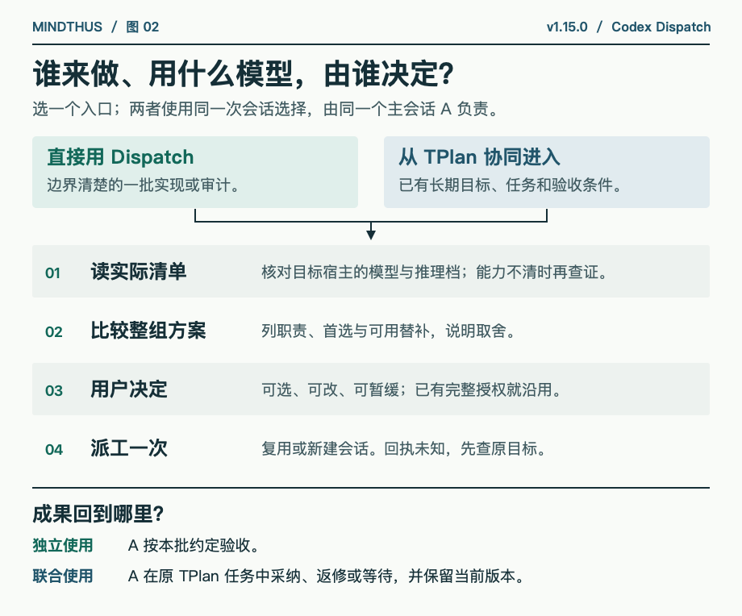

# Mindthus v1.15.0：Codex Dispatch 与 TPlan 协同

发布日期：2026-11-18。Stable 小版本。现在可以单独用 **Codex Dispatch** 给一批工作选会话和模型，也可以只点名 **TPlan**：在 Codex 的协同模式中，A 会默认调用 Dispatch，目标、授权和最终验收都留在同一个任务里。

## 从上个版本看：谁来验收？

v1.14.0 引入 TPlan 多会话协同。下面以“导入全部 101 条记录”为例：B 交 v1，C 查出漏页；B 返修交 v2，C 对 v2 复审，A 才采纳。B 和 C 使用普通会话，只有 A 维护 Mission。

## 这个版本新增：怎么选会话？

Dispatch 先读取目标宿主的模型清单和推理档，能力存疑时集中查证，再给出整组方案和可用替补。用户可确认、改档或暂缓，已完整授权的组合可直接执行。创建结果未明时先向原目标对账；在新 Mission 中，A 可以先登记派工意图，再把晚到的正式会话 ID 绑定到这一次派工。

**怎么选：** 临时查证在当前会话做；范围清楚、只需分发一批开发和审计工作，用 Dispatch；要跟住多轮返修、暂停恢复和最终验收，用 TPlan 协同。[完整图解、场景对照和两条示例指令](../guides/tplan-and-dispatch.md)。

## 验证与升级

本版已验证真实宿主的模型清单、独立技能发现、已有 Sol 会话的实际派发与成果回收。晚到 ID 使用真实回执顺序在两种 Codex 安装包中回放；选型控件自由改档和取消的证据为受控演练。上版普通 A/B/C 的真实开发、审计、返修与复审记录见 [v1.14.0 发布说明](v1.14.0.md)。

产品包版本为 `1.15.0`，TPlan runtime generation 为 `1.7.0`。已固定旧运行时的 Mission 继续使用原版本，升级前保留原 writer；新 Mission 可使用延后绑定。Dispatch 随两种 Codex 布局提供；Claude Code 和 OpenCode 继续使用各自的 TPlan 协同方式。ROI Beta 已停止维护及后续发布。

下载：[mindthus-plugins-1.15.0.tar.gz](https://github.com/rv198-star/Mindthus/releases/download/v1.15.0/mindthus-plugins-1.15.0.tar.gz)（Codex、Claude Code 插件） · [mindthus-skills-1.15.0.tar.gz](https://github.com/rv198-star/Mindthus/releases/download/v1.15.0/mindthus-skills-1.15.0.tar.gz)（便携 Skills，含 OpenCode） · [SHA256SUMS](https://github.com/rv198-star/Mindthus/releases/download/v1.15.0/SHA256SUMS)（覆盖上述两份归档）。
